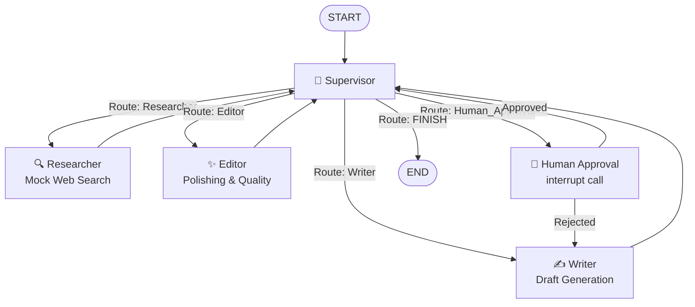

# 🚀 Multi-Agent Content Pod with Supervisor Routing & Human-in-the-Loop (HITL)

A production-grade, stateful Multi-Agent Content Generation system built with **LangGraph**, **Groq Llama-3.3-70B**, and **Streamlit**.

---

## 🏗️ Architecture Overview



### Pod Agents & Roles
1. **Supervisor (`supervisor_node`)**: Inspects message history and state artifacts, utilizing `llm.with_structured_output(NextStep)` to orchestrate execution in strict sequence:
   $$\text{Researcher} \longrightarrow \text{Writer} \longrightarrow \text{Editor} \longrightarrow \text{Human\_Approval} \longrightarrow \text{FINISH}$$
2. **Researcher (`researcher_node`)**: Mocks a live web search on the user's topic and extracts key industry insights, data points, and strategic takeaways into `research_notes`.
3. **Writer (`writer_node`)**: Synthesizes the research notes and any prior reviewer feedback into a comprehensive, structured draft saved to `draft`.
4. **Editor (`editor_node`)**: Refines clarity, eliminates filler, ensures publication-grade prose and formatting, and saves to `final_content`.
5. **Human Approval (`human_approval_node`)**: Calls LangGraph's native `interrupt({"draft": state["draft"]})` to pause execution. Awaiting human input:
   - **Approved**: Returns control to the Supervisor to conclude (`FINISH` $\to$ `END`).
   - **Rejected**: Routes back directly to the **Writer** for revision.

---

## 📁 Project Structure

```
├── schemas.py       # Pydantic models for routing (NextStep)
├── state.py         # GraphState TypedDict (messages, next_agent, research_notes, draft, final_content)
├── nodes.py         # Node functions powered by ChatGroq('llama-3.3-70b-versatile')
├── graph.py         # StateGraph assembly, conditional routing, and MemorySaver checkpointer
├── app.py           # Streamlit conversational UI with interactive HITL review buttons
├── requirements.txt # Project dependencies
├── .env.example     # Environment variable template
└── README.md        # Documentation and architecture guide
```

---

## 🛡️ Critical API Safety Guardrails

To prevent infinite recursion loops and protect your Groq API limits, every execution passes:
```python
config = {
    "configurable": {"thread_id": "1"},
    "recursion_limit": 10
}
```

---

## ⚡ Quick Start

### 1. Install Dependencies
```bash
pip install -r requirements.txt
```

### 2. Configure Environment Variables
Copy `.env.example` to `.env` and add your Groq API Key:
```bash
cp .env.example .env
```
Inside `.env`:
```ini
GROQ_API_KEY=gsk_your_groq_api_key_here
```
*(Alternatively, enter your API key directly in the Streamlit sidebar at runtime).*

### 3. Launch the Application
```bash
streamlit run app.py
```

---

## 🧪 HITL Flow in Streamlit

1. Enter a topic in the chat bar (e.g., *"Breakthroughs in Quantum Computing 2026"*).
2. Watch the multi-agent pod collaborate:
   - Supervisor $\to$ Researcher $\to$ Writer $\to$ Editor $\to$ Human_Approval
3. Execution pauses at the **Human-in-the-Loop review card**.
4. Select your decision:
   - **✅ Approve Content**: Resumes with `Command(resume="Approved")`, routes to Supervisor to finalize (`FINISH`).
   - **❌ Reject & Request Revision**: Resumes with `Command(resume="Rejected")`, routes back to `Writer`, who generates a revised draft, sends it to `Editor`, and re-triggers human review.
5. **📥 Download Publication Content**: Once approved, instant download buttons appear to export the finalized article as:
   - **`.md`** (Markdown document)
   - **`.txt`** (Plain text file)

